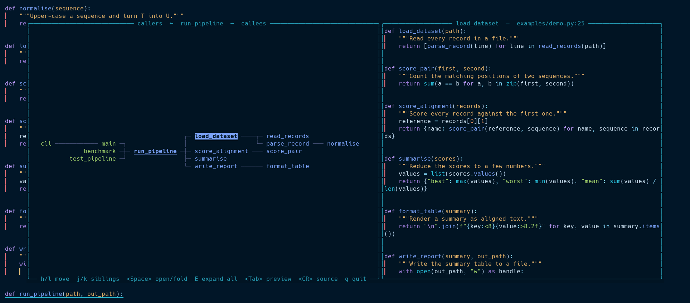

# callgraph.nvim

Explore Neovim's LSP call hierarchy as a graph that reads left to right, with a live source preview.

Put the cursor on a function and open the graph. The function sits in the middle, everything that calls it
branches off to the left, everything it calls branches off to the right, and a preview of the selected
function's source is always visible beside the graph.



The graph above was drawn from a real language server (pyright) on [examples/demo.py](examples/demo.py). `‹` and `›` mark functions whose callers or callees have not been loaded yet, and `↻` marks a recursive call.

## Features

- A single left-to-right graph with connector lines, centred in a large floating window.
- Callers on the left, callees on the right, and the preview on the right-hand side of the popup.
- Lazy loading: callers and callees are requested from the language server only when you open them.
- `E` expands everything under the selection, with depth and size limits so recursion cannot run away.
- The path from the selection back to the middle function is highlighted.
- Recursive calls are detected and not expanded again.
- Calls into the standard library and installed packages are hidden by default, so the graph shows your own code. Set `hide_external = false` to see them.
- Jump to the real source location with `<CR>`.

## Requirements

- Neovim 0.11 or later.
- A language server that supports call hierarchy, such as `pyright`, `basedpyright`, `clangd`,
  `rust-analyzer`, `gopls`, `tsserver` or `jdtls`. Servers without call hierarchy support (for example
  `lua_ls`) will show a warning.

## Installation

With [lazy.nvim](https://github.com/folke/lazy.nvim):

```lua
{
  "TylerIllman/callgraph.nvim",
  cmd = "Callgraph",
  keys = {
    { "<leader>cg", "<cmd>Callgraph<cr>", desc = "Call graph" },
  },
  opts = {}, -- see Configuration
}
```

The plugin does not set any global keymap. Bind `:Callgraph` to whatever you like.

## Usage

Put the cursor on a function and run `:Callgraph`.

| Key         | Action                                                                     |
| ----------- | -------------------------------------------------------------------------- |
| `l`         | Move right: into the callees (loading them if needed), or back toward the middle from a caller. |
| `h`         | Move left: into the callers, or back toward the middle from a callee.      |
| `j` / `k`   | Move to the next or previous function in the same column.                  |
| `<Space>`   | Open the callers or callees of the selected function, or fold them again. The selection stays put. |
| `E`         | Expand everything under the selection.                                     |
| `<Tab>`     | Focus the preview window. Press `<Tab>`, `<Esc>` or `q` there to come back. |
| `<CR>`      | Jump to the selected function in your editor and close the popup.          |
| `<C-d>` / `<C-u>` | Scroll the preview.                                                  |
| `q` / `<Esc>` | Close.                                                                   |

On the middle function, `h` goes to its callers and `l` goes to its callees, and `<Space>` opens or folds
both sides together.

## Configuration

Defaults:

```lua
require("callgraph").setup({
  width = 0.94,        -- popup width as a fraction of the editor
  height = 0.9,        -- popup height as a fraction of the editor
  graph_ratio = 0.56,  -- share of the popup used by the graph; the rest is the preview
  border = "rounded",
  hide_external = true, -- hide functions defined outside the workspace (stdlib, site-packages)
  max_expand_depth = 6,
  max_expand_nodes = 400,
  max_label = 34,      -- longer function names are shortened
  mappings = {
    left = "h",
    right = "l",
    down = "j",
    up = "k",
    toggle = "<Space>",
    expand_all = "E",
    focus_preview = "<Tab>",
    open = "<CR>",
    close = "q",
    scroll_down = "<C-d>",
    scroll_up = "<C-u>",
  },
})
```

Set any mapping to `false` to skip it. The arrow keys and `<Esc>` always work as well.

### Highlight groups

| Group             | Default link / style     | Used for                                  |
| ----------------- | ------------------------ | ----------------------------------------- |
| `CallgraphCaller` | `String`                 | Caller names.                             |
| `CallgraphCallee` | `Function`               | Callee names.                             |
| `CallgraphRoot`   | `Title`                  | The function in the middle.               |
| `CallgraphPath`   | bold, underline          | The path from the selection to the middle.|
| `CallgraphSel`    | reverse, bold            | The selected function.                    |
| `CallgraphEdge`   | `Comment`                | Connector lines.                          |

All groups are defined with `default = true`, so your own definitions win.

## How it works

The plugin sends `textDocument/prepareCallHierarchy` for the symbol under the cursor, then
`callHierarchy/incomingCalls` and `callHierarchy/outgoingCalls` for each node you open. The visible nodes
are laid out in columns by depth, with each parent centred on its children, drawn onto a character grid with
box-drawing junctions, and written into a scratch buffer. The preview is the real file buffer shown in a
second floating window, with the function's lines highlighted.

## Limitations

- It uses the first attached client that supports call hierarchy.
- Very large graphs are limited by `max_expand_depth` and `max_expand_nodes`.

## Development

```sh
nvim --headless -u NONE -l tests/run.lua
```

The tests use a fake language server and need no dependencies. Issues and pull requests are welcome.

## License

MIT. See [LICENSE](LICENSE).
